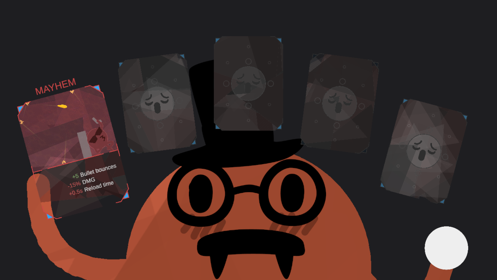

# Vampire Rounds (Vampire Survivors x ROUNDS)

A new adventure in Vampire Survivors's Adventures menu where you play ROUNDS's Orange or Blue.

**On Melty:** [melty.gg/m/vampire-rounds](https://melty.gg/m/vampire-rounds) (not published yet; once it is, one click with
your own Steam copies of Vampire Survivors and ROUNDS).

## What you get

- **ROUNDS's real players.** Your own ROUNDS runs hidden in the background and draws Orange and Blue the way ROUNDS
  does (the face you made in ROUNDS, legs, gun, health bar) over Vampire Survivors's stage, exactly where VS puts them.
- **ROUNDS's gun instead of VS's weapons.** It fires by itself at the nearest enemy (the mouse aims it while it
  moves), with ROUNDS's ammo, reload and bullets; right mouse or Space is ROUNDS's block. ROUNDS runs the gun, so
  every card works with ROUNDS's own code: Bouncy bounces off the screen edges, Poison ticks, explosions hit crowds.
- **Every level-up and treasure chest is a ROUNDS card pick.** ROUNDS's own pick screen (5 cards, its rarities, art
  and rules); the card goes into your ROUNDS player at once, and ROUNDS's card bar shows your deck.
- **Vampire Survivors's night.** The Mad Forest, its enemies, bosses, gems, gold and pickups are VS's own. VS decides
  when an enemy's hit lands (its own pacing); the hit takes ROUNDS's health, and ROUNDS's death ends the VS life
  (VS's revivals bring ROUNDS's player back). ROUNDS's slows, stuns and silences land as VS's own slow, freeze and
  defang.
- **Its own adventure.** Its own progress, roster (Orange and Blue, both open from the start) and stage; no VS
  merchants (they sell VS weapons). Your VS story and characters are untouched; Orange and Blue only appear in it.

Needs ROUNDS on its **old-rounds-for-mods** Steam beta branch (ROUNDS > Properties > Betas).

## How it works

- `Mods/VampireRounds.dll` (src/VsMod): the MelonLoader mod for VS. It adds the adventure (VS's unused
  `ADV_LIB_001` slot), its stage (a copy of the player's own Mad Forest data under the unused `TEST` stage slot),
  Orange and Blue (VS's own custom-character system), starts the hidden ROUNDS, and runs the link every frame.
- `Plugins/VampireRounds.InteropFix.dll` (src/InteropFix): MelonLoader 0.7.3's Il2CppInterop cannot find
  `Class::GetDefaultFieldValue` on VS's Unity 6 build and VS crashes two seconds after start with any MelonLoader
  mod; this points the hook at the right function (the byte pattern was first found by the Isaac Survivors mashup).
- `UserData/VampireRounds/rounds` (src/Engine + BepInEx 5.4.23.2): loaded into ROUNDS from where Melty installs it
  with Doorstop's command-line arguments (its log: `UserData/VampireRounds/rounds/BepInEx/LogOutput.log`); the engine is
  [Roundhead](https://github.com/neednotapply/roundhead)'s ROUNDS arena (MIT, the same creator) adapted to VS: Orange and Blue held where VS puts them, VS's enemies
  mirrored as trigger circles, the screen edges as walls, bullets flying straight. ROUNDS still opens a window in batch
  mode; it is kept off screen as a tool window that takes no focus.
- `version.dll` in the ROUNDS folder: UnityDoorstop 4 (from BepInEx 5.4.23.2, byte-identical to Roundhead's); it does
  nothing unless ROUNDS is started with Vampire Rounds's arguments.
- The two games talk through shared memory (`Local\VampireRoundsArena1`, sheets/link.json): VS writes the camera,
  each seat's position and input, the enemies and events; ROUNDS writes health, hits, effects, card picks and its
  rendered picture (players and bullets; card bar; pick screen).

Nothing from either game is in this repository or the package: each player's own ROUNDS draws the characters and
runs the cards, and their own VS supplies the stage.

## Building

Windows, .NET SDK 8, Python 3 with Pillow, your own VS and ROUNDS on Steam.

1. Interop assemblies for VS: run Cpp2IL 2022.1.0-pre-release.21 (`--output-as dummydll`) on VS, then
   Il2CppInterop.CLI 1.5.1 `generate --use-opt-out-prefixing` with Unity 6000.0.62's libraries, into
   `~/vsr-work/vs-interop` (MelonLoader makes the same ones on the first start).
2. BepInEx 5.4.23.2 (`BepInEx_win_x64_5.4.23.2.zip` from its GitHub releases) unpacked into `~/vsr-work/dl/bepinex`,
   and the license texts (BepInEx, UnityDoorstop, HarmonyX, MonoMod, Mono.Cecil) in `~/vsr-work/dl/licenses`.
3. The design sheets in `sheets/` are the source of truth: `python -I tools/sheets.py gen`, then
   `python -I tools/sheets.py preflight --code` (must say clean; it checks hook targets against your decompiled games).
4. `python -I tools/package.py 0.1.1` builds all three projects and writes `dist/VampireRounds-0.1.1.zip`; Melty installs
   it with the recipe in `tools/recipe.json`.
5. Developer runs: `devtools/devinstall.py on|off` (puts the staged build into your games and takes it out again),
   `devtools/run.ps1 -Auto [-Slow] [-Hero blue] [-Cards "Explosive Bullet"]` (self-playing runs, optionally starting with ROUNDS cards), `devtools/shots.sh` (screenshots).

## Test mode

While `%LOCALAPPDATA%\Melty\test\vampire-rounds.json` exists, the mod plays by itself (into the adventure as Orange,
walking a circle, taking picks) and writes `pass <check>` lines for: engine-ready, adventure-listed, run-started,
rounds-drawn, gun-fired, enemy-hit, card-picked.

## License

MIT (LICENSE.txt). Third-party in the package: BepInEx (MIT), UnityDoorstop (LGPL-2.1), HarmonyX (MIT), MonoMod (MIT),
Mono.Cecil (MIT).
